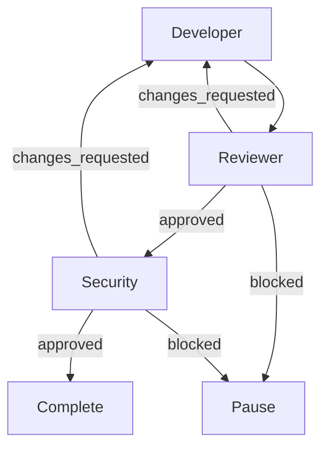

# Interfaces

The plugin exposes the same run model through four surfaces: RPC, the server `/flowgraph` command, the TUI, and the experimental Desktop GUI.

## RPC

The plugin registers the `flowgraph` RPC at each OpenCode location where it is loaded. The shared contract is exported from `@alvarolorentedev/opencode-flowgraph/rpc`.

```ts
import { OpenCode } from "@opencode/client"
import { FlowgraphRpc } from "@alvarolorentedev/opencode-flowgraph/rpc"

const client = OpenCode.make({ baseUrl, headers })
const workflows = client.rpc(FlowgraphRpc)
const location = { directory: "/workspace/project" }

const workflowsList = await workflows.listWorkflows(undefined, { location })

const started = await workflows.startRun(
  {
    workflowID: "development",
    objective: "Implement the requested change.",
    requestID: crypto.randomUUID(),
  },
  { location },
)

let detail = await workflows.getRun({ runID: started.runID }, { location })
while (detail.run.status === "running" || detail.run.status === "pausing") {
  await new Promise((resolve) => setTimeout(resolve, 1_000))
  detail = await workflows.getRun({ runID: started.runID }, { location })
}

const unsubscribe = workflows.events.on("runUpdated", (event) => {
  if (event.location.directory !== location.directory) return
  console.log(event.data.runID, event.data.status, event.data.currentNode)
})
```

Events are live-only. After reconnecting, call `listRuns` or `getRun`.

### Human steps

A run waiting on a `human: true` node exposes a `human_input` blocker with its declared `outcomes`. Answer it with the current revision:

```ts
await workflows.respondRun(
  {
    runID,
    requestID: crypto.randomUUID(),
    expectedRevision,
    nodeID: "signoff",
    outcome: "approved",
    summary: "Approved",
    feedback: "Ship it",
  },
  { location },
)
```

Omit `nodeID` when exactly one human step is waiting. A decision is stored as a completed step with `agentID: "human"` and counts toward `max_steps`.

### Methods

| Method | Purpose |
|---|---|
| `capabilities` | Plugin, RPC, schema, feature, and limit versions |
| `harnessCapabilities` | Active adapter's validated harness capabilities (identity, agents, sessions, results, permissions, security, usage, audit) |
| `listWorkflows` | Discover project workflows and validation state |
| `getWorkflow` | Raw YAML, validated graph, agents, Mermaid |
| `validateWorkflow` | Validate YAML without writing |
| `saveWorkflow` | Create/update with a hash precondition |
| `deleteWorkflow` | Delete with a hash precondition |
| `startRun` | Start a run with an objective and idempotency key |
| `listRuns` | List project runs |
| `getRun` | Current state, step summaries, Mermaid, live permissions |
| `getRunGraph` | Structured graph, active steps, blockers, grouped child sessions, Mermaid mapping, controls |
| `getRunStep` | Full persisted step result |
| `pauseRun` | Safe pause between nodes |
| `resumeRun` | Resume, with explicit confirmation for ambiguous retries |
| `respondRun` | Answer a waiting human step with a declared outcome and feedback |
| `cancelRun` | Cancel future execution and interrupt active work |

Event: `runUpdated` with project, run, workflow, status, current node, revision, timestamp, and blocker. Events are live-only notifications; reconnecting clients must call `getRun` or `listRuns`.

Run details and graphs expose all active steps and blockers. The singular fields remain a primary view for existing callers. Step records from called workflows include `workflowID` and `callPath`.

A run owned by another harness is visible through `listRuns`, `getRun`, and
`getRunGraph`, with additive `harness: { id, version? }` and `readOnly: true`
fields on that run only. OpenCode-owned and adopted legacy runs omit both, so
their payloads are unchanged. A foreign run reports `resumable: false`, all four
controls false, and the stored permissions; the plugin never queries the other
harness's native session. A legacy run with no sidecar is read-only with
`readOnly: true` and no `harness` field when the active adapter has
`sessions.adoptLegacyRuns: false`. `pauseRun`, `resumeRun`, `respondRun`, and
`cancelRun` still return `not_resumable` for both.

All methods are location-scoped. The plugin rejects runs that belong to another project or canonical checkout. No `projectID` is accepted from the client.

### HTTP

The generic RPC route is:

```text
POST /api/rpc/flowgraph/{method}
```

The body is `{ "input": ... }`, and the response is `{ "output": ... }`. Pass `location[directory]` as a query parameter when the request is not already location-scoped.

### Errors

Declared errors include:

- `not_found`
- `invalid_input`
- `invalid_workflow`
- `unsafe_path`
- `stale_revision`
- `not_owner`
- `project_busy` (legacy)
- `idempotency_conflict`
- `too_many_runs`
- `permission_pending`
- `ambiguous_requires_confirmation`
- `not_resumable`
- `invalid_state`
- `unavailable`

Error data contains IDs, validation diagnostics, the current revision, or redacted permission summaries. It never contains prompts, objectives, YAML source, tool inputs, provider bodies, or credentials.

### Control semantics

- `pauseRun` sets `pausing` while admitted sessions drain, then sets `paused` with the remaining branches checkpointed.
- `resumeRun` requires the current `expectedRevision`.
- `resumeRun` returns `permission_pending` while a native permission request is outstanding.
- `resumeRun` requires `confirmRetry: true` to retry ambiguous steps. Other branches retain their checkpoints and live sessions.
- `resumeRun` returns `not_resumable` when the only remaining work is a human step; use `respondRun`.
- `respondRun` accepts a `nodeID` when several human steps wait, records the decision as a step, and routes like an agent outcome. An undeclared outcome returns `invalid_input`.
- `cancelRun` marks the run cancelled and requests interruption of every outstanding session in that run.
- An idempotent retry with the same `requestID` returns the current run.
- `startRun` uses `requestID` plus the workflow/objective hash to detect conflicting retries.
- A foreign-harness run is read-only: control methods return `not_resumable` even if a client ignores the false graph controls.

## Server /flowgraph command

The server part registers a `flowgraph` slash command, so API-driven clients (mobile, web) that only see server commands via `command.list` can use the plugin without the TUI or Desktop GUI:

- `/flowgraph list` — list workflows
- `/flowgraph run <workflow-id> <objective...>` — start a run
- `/flowgraph runs` — list runs
- `/flowgraph graph <runID>` — describe one run

The command replies with plain text in the invoking session as a notice that does not resume the agent. It cannot open panels or dialogs; pause, resume, and cancel stay on RPC (`pauseRun`, `resumeRun`, `cancelRun`) and the TUI/GUI surfaces.

A foreign-harness run is marked with ` · [<id>]` in `runs` output. A run
without a harness identity is marked ` · [read-only]`. `graph` adds
`Harness: <id> (read-only via RPC)` (or `Run is read-only via RPC (no harness
identity).`) and omits the `respondRun` hint. OpenCode output is unchanged.

## TUI

The package ships a TUI part. It adds a full-screen `Workflow` page, a `Workflow graph` session panel, and a `/flowgraph` command.

### Open it

1. Run `/flowgraph` or use the command palette: **Workflow**.
2. If the current session belongs to a workflow run, the graph opens in its session panel.
3. Otherwise the full-screen workflow page opens. No session is required.

The page lists every workflow run visible on the connected server, including runs in other projects and worktrees. Select a run to see its structured graph.

### Commands

| Command | Action |
|---|---|
| `/flowgraph` or `/flowgraph graph` | Open the current workflow session panel, or the all-runs page. |
| `/flowgraph visuals` | Same as `graph`. |
| `/flowgraph runs` | Open the all-runs page. |
| `/flowgraph list` | List available workflows and start one. |
| `/flowgraph run <workflow-id> <objective...>` | Start a run. |
| `/flowgraph <workflow-id> <objective...>` | Shorthand for `run`. |

Starting a workflow asks for a missing workflow ID or objective with a dialog, then opens the new run's own session and graph panel.

### What it shows

- Every run on the server: workflow, status, directory, and objective. A foreign
  run appends ` · [<id>]` after the status.
- The active harness under the page header: `Active harness: <id> <version>`,
  then its result mechanism, approval surface, protected-path level, and
  background-work behavior. While loading it shows `Active harness: loading…`;
  a missing or failed method shows `Active harness capabilities unavailable.`
  without blocking runs. Warnings appear when background work is unobservable,
  protected paths are not intercepted, or protected paths are only
  `best_effort` (shell inspection is heuristic; native permissions remain the
  boundary). `best_effort` is an additive capability value: the published 1.0.0
  client has no capability display and ignores it. A plugin-running TUI whose
  version differs from the server's shows its version-mismatch restart message
  instead of loading a graph (see [Loading](#loading)); some Desktop versions
  render the capability lines only as text.
- Workflow and run identity for the selected run.
- Status, revision, step count, blocker, and pending native permissions.
- A boxed top-down diagram: nodes are boxes, branches sit side by side, cycles route around a left-hand rail, long jumps around a right-hand rail, and rail edges enter boxes from the side.
- Outcome labels sit on their own row, or beside a vertical edge, so lines stay unbroken.
- Nodes with completed (green), active (yellow), failed or routed-back (red), paused, and pending markers and colours.
- Outcome-labelled edges, including cycles and terminal edges.
- Active nodes are highlighted. Called workflows show child progress under their call nodes.
- The session panel repeats the active harness lines once. The page and panel
  add `Harness <id> · read-only in this client` for a foreign run; an unadopted
  legacy run adds `Read-only in this client · harness identity unavailable`. Its
  controls and session keys are gated with a toast and its native session is
  never opened.

The TUI does not render Mermaid. It renders the structured graph from `getRunGraph` directly. If the diagram does not fit the available width or height, the page falls back to a compact text list and says why.

### Keys

Workflow page:

| Key | Action |
|---|---|
| `up` / `down` | Select a run |
| `o` | Open the selected run's session with its graph panel |
| `enter` | Open the primary active session |
| `s` | Pick any workflow session, grouped by graph node |
| `u` | Answer a human step, resume, or retry ambiguous steps while siblings run |
| `p` | Answer a blocked human step; otherwise pause or resume |
| `c` | Cancel the run |
| `r` | Refresh |

Session panel:

| Key | Action |
|---|---|
| `enter` | Open the primary active session |
| `s` | Pick any workflow session, grouped by graph node |
| `u` | Answer a human step, resume, or retry ambiguous steps while siblings run |
| `p` | Answer a blocked human step; otherwise pause or resume |
| `c` | Cancel the run |
| `r` | Refresh |

The page and panel receive `runUpdated` events and refresh periodically as a fallback.

For a foreign run, `u`, `p`, `c`, `s`, `o`, and `enter` explain why the action is
unavailable instead of acting; `r` still refreshes. The page and session panel
never open a foreign native session. An unadopted legacy run with no harness
identity is gated the same way.

### Loading

The TUI part is exported as `./tui`. OpenCode loads it with the package's server part. For a TUI connected to a remote server, make sure the plugin is available in the TUI's plugin configuration as documented by OpenCode.

If no run appears, the page shows an explicit message. Runs are stored in the plugin storage of the server that started them; a TUI connected to a different server will not see another server's runs.

The page and panel also check the server plugin version through `capabilities`. If the TUI and server parts differ, they show a version-mismatch message instead of loading forever. Restart OpenCode after updating the plugin, and make sure the old `opencode-agent-workflows` package is removed from `opencode.json(c)` and `cli.json`.

## Desktop GUI

The package ships an experimental OpenCode Desktop GUI part, `./gui-experimental`.

### What it shows

- The generated Mermaid graph.
- Active nodes highlighted and child sessions grouped under their call nodes.
- Completed nodes styled green, nodes whose latest route looped back red until a later attempt passes, active nodes yellow, and failed/paused/pending nodes styled by state.
- Run status, revision, failure reason, blocker, and pending permission count.
- The active harness capability lines and warnings in the panel header, labeled
  **Active harness**.
- Click a node to open its native session. A node without a session shows a toast instead.
- Buttons for changing runs, pause, resume, respond to a human step, cancel, and graph zoom.
- Live updates from `runUpdated`, with polling as a fallback.

A foreign-harness run adds a read-only line to the header; its picker title
appends ` · <id>`. Selecting it opens its graph read-only in the current
session's Workflow panel, loaded by that run's directory and ID. A run without a
harness identity is labeled ` · read-only` and opens the same way. The header
shows the run ID, full directory, revision, and ownership line; Open active
session, Pause, Resume, Respond, Cancel, and child session buttons are disabled
with the reason `Unavailable for <id> runs` (or `Read-only run` without an
identity). Node clicks and the run picker do not open a foreign native session,
and a foreign/legacy run never triggers a native session lookup or waits for a
run session. Runs and Zoom remain enabled. Desktop cannot open a panel without a
session, so selecting a read-only run with no session open shows
`Open a session first: the read-only graph opens in that session's Workflow panel.`
The target clears when the panel closes or an owned run is selected; it is not
persisted. Owned runs keep their existing session-opening flow; the graph title
reads `Inspecting <workflow>` and the metadata line adds the run directory.

### Multiple runs

Each workflow run has its own root session. Opening a run opens that session's tab and adds a graph panel to it, so several runs can stay open as separate graph tabs.

The **Workflow** command opens a run picker containing every run on the current server, across projects and worktrees. The **Runs** button in the graph panel reopens it. An unrelated session never silently shows another run's graph; a foreign run appears only when explicitly opened into that session's Workflow panel. If some project or worktree locations cannot be listed, the picker title appends ` · N location(s) unavailable`, and an empty picker says `No workflow runs visible; N location(s) unavailable.` instead of claiming there are no runs.

Runs are stored in the plugin storage of the server that started them. Desktop loads GUI parts from its own background server, so the TUI and Desktop must use the same server to see the same runs.

### Requirements

- OpenCode Desktop with the experimental GUI plugin API.
- The plugin must be configured in the **global** `opencode.json(c)` so Desktop can load the GUI bundle.
- The server part must load successfully. A plugin whose server part fails has no GUI.

### Build

The GUI entry must be one prebuilt CommonJS file:

```sh
bun run build:gui
```

This writes `dist/gui-experimental.cjs`. The release workflow and `prepublishOnly` build it automatically.

The Desktop GUI API is experimental and may change between OpenCode releases. The server RPC and TUI graph use the stable structured `getRunGraph` model, so changes to the GUI part do not affect the orchestrator.

## Mermaid

Mermaid is derived output, never an input or execution format. `renderMermaid(graph)` is a pure exported function; the RPC returns the same string. Output is deterministic, uses synthetic safe node IDs, and escapes labels. No `click`, `style`, or other executable directives are emitted.


