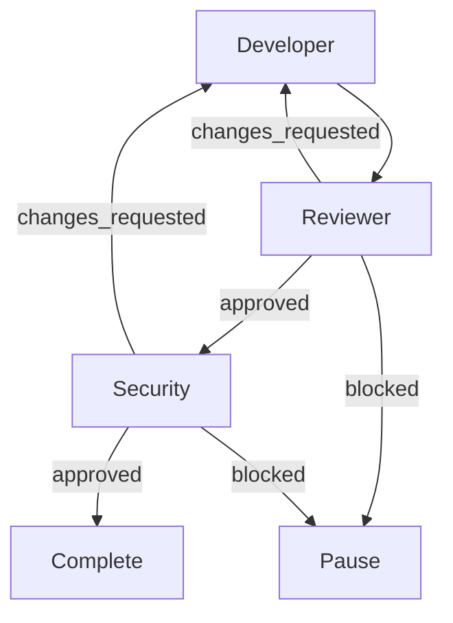

# Interfaces

The plugin exposes the same run model through four surfaces: RPC, the server `/flowgraph` command, the TUI, and the experimental Desktop GUI.

## RPC

The plugin registers the `flowgraph` RPC at each OpenCode location where it is loaded. The shared contract is exported from `@alvarolorentedev/opencode-flowgraph/rpc`.

```ts
import { OpenCode } from "@opencode/client"
import { FlowgraphRpc } from "@alvarolorentedev/opencode-flowgraph/rpc"

const client = OpenCode.make({ baseUrl, headers })
const workflows = client.rpc(FlowgraphRpc)
const location = { directory: "/workspace/project" }

const workflowsList = await workflows.listWorkflows(undefined, { location })

const started = await workflows.startRun(
  {
    workflowID: "development",
    objective: "Implement the requested change.",
    requestID: crypto.randomUUID(),
  },
  { location },
)

let detail = await workflows.getRun({ runID: started.runID }, { location })
while (detail.run.status === "running" || detail.run.status === "pausing") {
  await new Promise((resolve) => setTimeout(resolve, 1_000))
  detail = await workflows.getRun({ runID: started.runID }, { location })
}

const unsubscribe = workflows.events.on("runUpdated", (event) => {
  if (event.location.directory !== location.directory) return
  console.log(event.data.runID, event.data.status, event.data.currentNode)
})
```

Events are live-only. After reconnecting, call `listRuns` or `getRun`.

### Methods

| Method | Purpose |
|---|---|
| `capabilities` | Plugin, RPC, schema, feature, and limit versions |
| `listWorkflows` | Discover project workflows and validation state |
| `getWorkflow` | Raw YAML, validated graph, agents, Mermaid |
| `validateWorkflow` | Validate YAML without writing |
| `saveWorkflow` | Create/update with a hash precondition |
| `deleteWorkflow` | Delete with a hash precondition |
| `startRun` | Start a run with an objective and idempotency key |
| `listRuns` | List project runs |
| `getRun` | Current state, step summaries, Mermaid, live permissions |
| `getRunGraph` | Structured graph, run and run-session IDs, active node, node sessions, Mermaid mapping, controls |
| `getRunStep` | Full persisted step result |
| `pauseRun` | Safe pause between nodes |
| `resumeRun` | Resume, with explicit confirmation for ambiguous retries |
| `cancelRun` | Cancel future execution and interrupt active work |

Event: `runUpdated` with project, run, workflow, status, current node, revision, timestamp, and blocker. Events are live-only notifications; reconnecting clients must call `getRun` or `listRuns`.

All methods are location-scoped. The plugin rejects runs that belong to another project or canonical checkout. No `projectID` is accepted from the client.

### HTTP

The generic RPC route is:

```text
POST /api/rpc/flowgraph/{method}
```

The body is `{ "input": ... }`, and the response is `{ "output": ... }`. Pass `location[directory]` as a query parameter when the request is not already location-scoped.

### Errors

Declared errors include:

- `not_found`
- `invalid_input`
- `invalid_workflow`
- `unsafe_path`
- `stale_revision`
- `not_owner`
- `project_busy`
- `idempotency_conflict`
- `too_many_runs`
- `permission_pending`
- `ambiguous_requires_confirmation`
- `not_resumable`
- `invalid_state`
- `unavailable`

Error data contains IDs, validation diagnostics, the current revision, or redacted permission summaries. It never contains prompts, objectives, YAML source, tool inputs, provider bodies, or credentials.

### Control semantics

- `pauseRun` sets `pausing` while a node is active and `paused` between nodes. It does not interrupt the active node.
- `resumeRun` requires the current `expectedRevision`.
- `resumeRun` on a permission-blocked node returns `permission_pending` until the native decision is made.
- `resumeRun` on an ambiguous node requires `confirmRetry: true`.
- `cancelRun` interrupts the active node where supported and marks the run cancelled.
- An idempotent retry with the same `requestID` returns the current run.
- `startRun` uses `requestID` plus the workflow/objective hash to detect conflicting retries.

## Server /flowgraph command

The server part registers a `flowgraph` slash command, so API-driven clients (mobile, web) that only see server commands via `command.list` can use the plugin without the TUI or Desktop GUI:

- `/flowgraph list` — list workflows
- `/flowgraph run <workflow-id> <objective...>` — start a run
- `/flowgraph runs` — list runs
- `/flowgraph graph <runID>` — describe one run

The command replies with plain text in the invoking session as a notice that does not resume the agent. It cannot open panels or dialogs; pause, resume, and cancel stay on RPC (`pauseRun`, `resumeRun`, `cancelRun`) and the TUI/GUI surfaces.

## TUI

The package ships a TUI part. It adds a full-screen `Workflow` page, a `Workflow graph` session panel, and a `/flowgraph` command.

### Open it

1. Run `/flowgraph` or use the command palette: **Workflow**.
2. If the current session belongs to a workflow run, the graph opens in its session panel.
3. Otherwise the full-screen workflow page opens. No session is required.

The page lists every workflow run visible on the connected server, including runs in other projects and worktrees. Select a run to see its structured graph.

### Commands

| Command | Action |
|---|---|
| `/flowgraph` or `/flowgraph graph` | Open the current workflow session panel, or the all-runs page. |
| `/flowgraph visuals` | Same as `graph`. |
| `/flowgraph runs` | Open the all-runs page. |
| `/flowgraph list` | List available workflows and start one. |
| `/flowgraph run <workflow-id> <objective...>` | Start a run. |
| `/flowgraph <workflow-id> <objective...>` | Shorthand for `run`. |

Starting a workflow asks for a missing workflow ID or objective with a dialog, then opens the new run's own session and graph panel.

### What it shows

- Every run on the server: workflow, status, directory, and objective.
- Workflow and run identity for the selected run.
- Status, revision, step count, blocker, and pending native permissions.
- A boxed top-down diagram: nodes are boxes, branches sit side by side, cycles route around a left-hand rail, long jumps around a right-hand rail, and rail edges enter boxes from the side.
- Outcome labels sit on their own row, or beside a vertical edge, so lines stay unbroken.
- Nodes with completed (green), active (yellow), failed or routed-back (red), paused, and pending markers and colours.
- Outcome-labelled edges, including cycles and terminal edges.
- The active node is highlighted and pulses while the panel is visible.

The TUI does not render Mermaid. It renders the structured graph from `getRunGraph` directly. If the diagram does not fit the available width or height, the page falls back to a compact text list and says why.

### Keys

Workflow page:

| Key | Action |
|---|---|
| `up` / `down` | Select a run |
| `o` | Open the selected run's session with its graph panel |
| `enter` | Open the active node's native session |
| `p` | Pause or resume |
| `c` | Cancel the run |
| `r` | Refresh |

Session panel:

| Key | Action |
|---|---|
| `enter` | Open the active node's native session |
| `p` | Pause or resume |
| `c` | Cancel the run |
| `r` | Refresh |

The page and panel receive `runUpdated` events and refresh periodically as a fallback.

### Loading

The TUI part is exported as `./tui`. OpenCode loads it with the package's server part. For a TUI connected to a remote server, make sure the plugin is available in the TUI's plugin configuration as documented by OpenCode.

If no run appears, the page shows an explicit message. Runs are stored in the plugin storage of the server that started them; a TUI connected to a different server will not see another server's runs.

The page and panel also check the server plugin version through `capabilities`. If the TUI and server parts differ, they show a version-mismatch message instead of loading forever. Restart OpenCode after updating the plugin, and make sure the old `opencode-agent-workflows` package is removed from `opencode.json(c)` and `cli.json`.

## Desktop GUI

The package ships an experimental OpenCode Desktop GUI part, `./gui-experimental`.

### What it shows

- The generated Mermaid graph.
- The active node highlighted.
- Completed nodes styled green, nodes whose latest route looped back red until a later attempt passes, the active node yellow, and failed/paused/pending nodes styled by state.
- Run status, revision, failure reason, blocker, and pending permission count.
- Click a node to open its native session. A node without a session shows a toast instead.
- Buttons for changing runs, pause, resume, cancel, and graph zoom.
- Live updates from `runUpdated`, with polling as a fallback.

### Multiple runs

Each workflow run has its own root session. Opening a run opens that session's tab and adds a graph panel to it, so several runs can stay open as separate graph tabs.

The **Workflow** command opens a run picker containing every run on the current server, across projects and worktrees. The **Runs** button in the graph panel reopens it. An unrelated session never silently shows another run's graph.

Runs are stored in the plugin storage of the server that started them. Desktop loads GUI parts from its own background server, so the TUI and Desktop must use the same server to see the same runs.

### Requirements

- OpenCode Desktop with the experimental GUI plugin API.
- The plugin must be configured in the **global** `opencode.json(c)` so Desktop can load the GUI bundle.
- The server part must load successfully. A plugin whose server part fails has no GUI.

### Build

The GUI entry must be one prebuilt CommonJS file:

```sh
bun run build:gui
```

This writes `dist/gui-experimental.cjs`. The release workflow and `prepublishOnly` build it automatically.

The Desktop GUI API is experimental and may change between OpenCode releases. The server RPC and TUI graph use the stable structured `getRunGraph` model, so changes to the GUI part do not affect the orchestrator.

## Mermaid

Mermaid is derived output, never an input or execution format. `renderMermaid(graph)` is a pure exported function; the RPC returns the same string. Output is deterministic, uses synthetic safe node IDs, and escapes labels. No `click`, `style`, or other executable directives are emitted.


